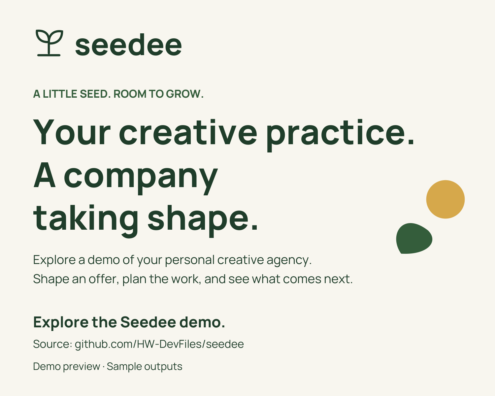
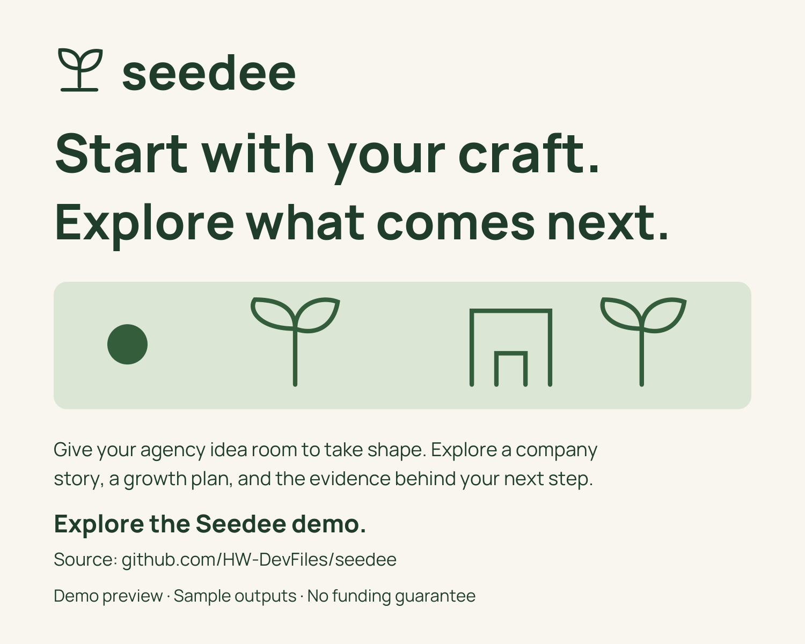
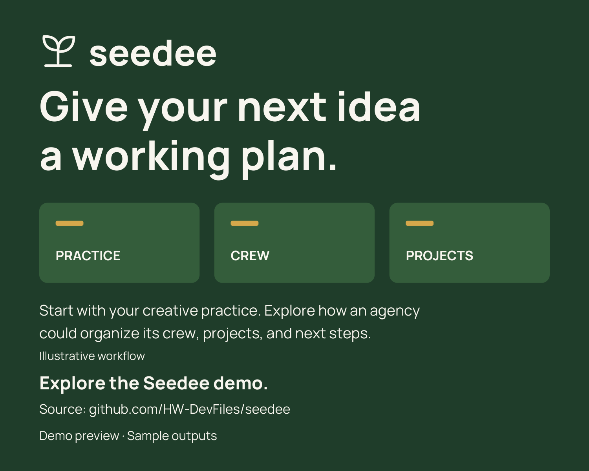

# Seedee flyer review set

Three distinct landscape designs, using Syd's final copy set. These files are owner-review artwork; public distribution awaits feature verification and a real demo destination from release. The printed repository address is labeled “Source” and is not a live demo destination.

| Stem (each has `.svg`, `.pdf`, `.png`) | Design / headline |
| --- | --- |
| `01-company-taking-shape` | Bold invitation: “Your creative practice. A company taking shape.” |
| `02-seed-to-studio` | Growth illustration: “Start with your craft. Explore what comes next.” |
| `03-working-plan` | Dark workflow: “Give your next idea a working plan.” |





All use “Explore the Seedee demo.” and “Demo preview · Sample outputs”. The seed-to-studio disclosure also says “No funding guarantee”. The growth shapes are symbolic, without a numerical scale or promised timeline. The workflow is labeled illustrative, without clients, completed work, or financial claims.

## Production specification

- Trim: 5 × 4 inches (360 × 288 PDF points).
- PDF MediaBox and BleedBox: 5.25 × 4.25 inches (378 × 306 points).
- PDF TrimBox: `[9, 9, 369, 297]`, providing 1/8 inch bleed on all sides.
- Full background extends through bleed. Text stays at least 1/4 inch inside trim.
- Posting PNG: exactly 1500 × 1200 pixels, rasterized from the PDF at 300 dpi after trimming. PNGs exclude bleed.
- Print PDF: vector artwork and embedded subset fonts; resolution independent, suitable for 300 dpi output. Full bleed raster equivalent is 1575 × 1275 pixels. No low resolution images.
- PDF color: RGB, without a printer-specific output profile or PDF/X claim. Ask the print provider to apply its stock/press profile and honor TrimBox at 100% scale. No crop marks are added inside bleed.
- SVG: editable vector source with embedded fonts, physical bleed dimensions and a `viewBox` including bleed. `build.py` is the shared editable scene source for PDF and SVG; edit it and regenerate to keep exports synchronized.

## Reproduce and verify

Requires Python 3.9+ and the free packages pinned in `requirements.txt`:

```sh
python3 -m venv /tmp/seedee-flyers-venv
/tmp/seedee-flyers-venv/bin/pip install -r marketing/flyers/requirements.txt
/tmp/seedee-flyers-venv/bin/python marketing/flyers/build.py
```

The build reopens all PDFs, checks page/trim/bleed boxes and extracted text, parses SVGs, verifies PNG decoding and exact pixel sizes, and checks text widths and safe margins. Visual review uses the PNGs rendered from each final PDF, so review reflects actual print geometry and font embedding. Do not stretch the PNGs or crop off disclosure text.

Reviewed locally: all three final PDF-derived PNGs for clipping, spacing and legibility. Browser preview via `chrome-devtools-axi` was unavailable at bridge startup; local ReportLab/PyMuPDF rendering produced the delivered assets. See `SOURCES.md` for licensing and copy provenance.
